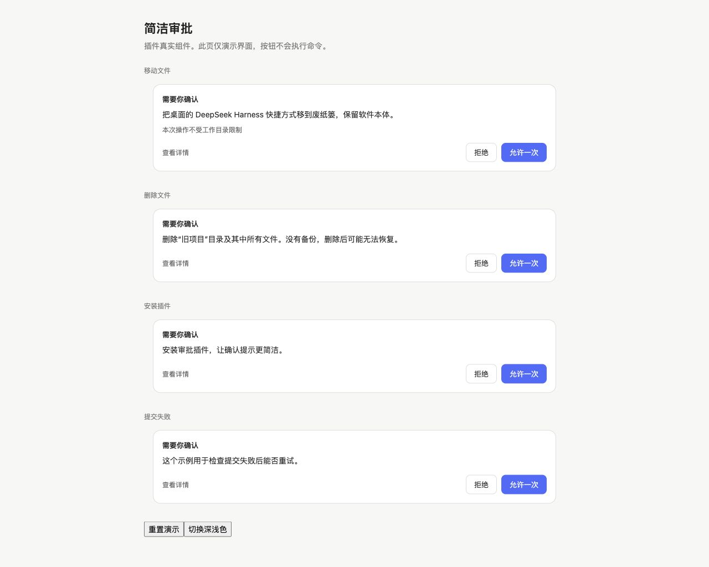

# 简洁审批 · dsh-approval-clear 0.2.0

审批时显示操作说明，以及「查看详情」「拒绝」「允许一次」。长说明最多预览 120 字；完整说明、工具名称、原始命令或操作参数都在详情中。



本插件只负责显示。权限判断、审批结果和命令执行由 DSH 原有模块处理。不会根据命令关键词宣称「安全」或「可恢复」，也不会自动批准。

## 2026-10-06 修复

- 修复启动卡在 Loading plugins：旧版重复注册系统 `approval` 字典，并重复声明系统拥有的 `conversation.approval.detail` 子插槽。两个冲突都能导致系统审批模块激活失败。新版使用独立字典，只注册审批界面，不声明或遮盖系统详情插槽。
- 修复回车误批准：各按钮使用浏览器正常键盘行为，回车按当前聚焦按钮执行；Esc 在卡片内拒绝。支持中文输入法保护。
- 修复连续审批无法点击：每次请求以真正的 React `key` 重新挂载；旧版把 key 误传成了 children。
- 修复本地化理由丢失：接入宿主的 `resolveText`。
- 命令按原文展示和复制，保留 `;`、`||`、`&&`、换行和空格。未知命令也能查看。
- 双击只提交一次；失效请求不可提交；提交失败显示重试提示。

## 验证

```sh
npm run build
npm test
npm run verify
npm run preview
```

`verify` 从已安装的 DeepSeek Harness 读取真实的 SlotCore 和 LocaleRuntime，检查宿主与插件的两种加载顺序、字典独立性、理由解析、请求 key、销毁清理，并复现旧版两个冲突。默认应用路径是 `/Applications/DeepSeek Harness.app/Contents/Resources/app.asar`，可用 `DSH_APP_ASAR` 指定其他位置。不会修改应用包。

预览使用真正的 React，所有决定都在演示页内模拟，不执行任何命令。生成器使用本机开发依赖里的 `react`、`react-dom` 和 `esbuild`，可用 `DSH_PREVIEW_NODE_MODULES` 指定依赖目录；也会查找本机 npm 缓存。运行插件本身无需安装这些依赖。

`preview/cards.html` 与 `preview/cards-dark.html` 可以本地打开。深色页的颜色是演示用主题变量；实际界面使用 DSH 当前主题。

## 当前安装

桌面 profile 已经通过 `link:` 指向本目录，且 `dsh.profile.bundles` 已包含本插件。修改本目录后，重启 DSH 生效。不要再在 profile patch 中重复插入 `approval-clear`。

停用可在插件页关闭本插件，系统审批界面会接回。无需修改系统模块。

修复前完整副本保存在工作区的 `_备份与存档/审批插件修复前-20261006/dsh-approval-clear/`。旧版存在已确认的启动冲突，不建议直接恢复启用。
